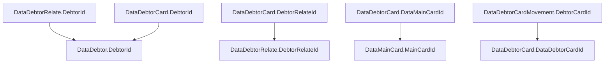

import DocPage from '../../components/DocPage'

export const metadata = { title: 'โครงสร้างและความสัมพันธ์' }

<DocPage eyebrow="ARCHITECTURE / DATA MODEL" title="แกนข้อมูลของระบบ" intro="แยกตัวบุคคล ความสัมพันธ์กับสัญญาค้ำประกัน และยอดหนี้ออกจากกัน ก่อนเชื่อมเพื่อทำรายงาน">

## 1. ตัวบุคคลและ LG

**[DataDebtor](/tables/dbo.DataDebtor/)** เก็บตัวตนลูกหนี้ ใช้ `DebtorId` เป็น Primary Key ส่วน `DebtorCode` คือรหัสลูกหนี้ในระบบ

**[DataLG](/tables/dbo.DataLG/)** เก็บข้อมูลค้ำประกันและชดเชย ใช้ `LGId` เป็น Primary Key มีเลข `LGNo` และ `CIFNo` เป็นรหัสธุรกิจ การเห็น `LGNo` ใน JOIN ไม่ได้ยืนยันว่าเลขนี้ unique ทุกแถว

**[DataDebtorRelate](/tables/dbo.DataDebtorRelate/)** เป็นจุดเชื่อมลูกหนี้กับ LG และบทบาทของลูกหนี้ เช่น ประเภทที่กำหนดด้วย `DebtorTypeId` ใช้ `DebtorRelateId` เป็น Primary Key

## 2. การ์ดหลัก การ์ดบุคคล และการเคลื่อนไหว

| ตาราง | บทบาทจากคำอธิบายและโครงสร้าง | Primary Key |
| --- | --- | --- |
| [DataMainCard](/tables/dbo.DataMainCard/) | การ์ดหลัก มี LG และองค์ประกอบภาระหนี้ | MainCardId |
| [DataDebtorCard](/tables/dbo.DataDebtorCard/) | การ์ดลูกหนี้รายบุคคล อ้างถึงการ์ดหลัก ลูกหนี้ และความสัมพันธ์ | DataDebtorCardId |
| [DataDebtorCardMovement](/tables/dbo.DataDebtorCardMovement/) | รายการเคลื่อนไหวของการ์ด มีวันที่ รายการรับชำระ เงินต้น ดอกเบี้ยและค่าใช้จ่าย | DebtorCardMovementId |

## 3. Foreign Keys ที่ยืนยันได้

ลูกศรชี้จากคอลัมน์ที่อ้างอิงไปยังคอลัมน์ปลายทางจริง

ความสัมพันธ์ผ่าน <code>LGNo</code> พบในโค้ด SQL เช่น <code>dbo.ForReport</code> แต่ไม่ควรเหมารวมว่าเป็น Foreign Key ที่ฐานข้อมูลบังคับทุกจุด ตรวจทั้ง constraint และโค้ดที่ใช้งานประกอบกัน

## 4. หลักการเลือกคีย์และรวมยอด

- เริ่มจาก Primary Key จริง อย่าแทน `DebtorId` ด้วย `DebtorCode` โดยไม่ตรวจความหมาย
- การ JOIN ลูกหนี้ → ความสัมพันธ์ → การ์ด อาจเพิ่มจำนวนแถว เพราะแต่ละระดับอาจมีหลายรายการ
- ยอดใน Card และรายการใน Movement เป็นข้อมูลคนละระดับ ต้องเลือกวันที่และระดับการรวมยอดก่อน SUM
- ตรวจ `IsDelete`, `IsActive` และสถานะตามกฎของกระบวนการนั้น ไม่ควรสมมติว่าใช้เงื่อนไขเดียวกันทุกตาราง

## 5. Schema ที่ต้องระบุให้ชัด

มีตารางชื่อซ้ำข้าม schema ได้แก่ `DataEndOfDay`, `NCBCommercialCreditData`, `NCBCommercialProfileData` และ `NCBConsumerData`

`dbo.DataEndOfDay` กับ `eod.DataEndOfDay` เป็นคนละตาราง เช่นเดียวกับตาราง NCB ใน `dbo` และ `ncb_internal` เอกสารทุกหน้าจึงระบุชื่อเต็ม `schema.table`

</DocPage>